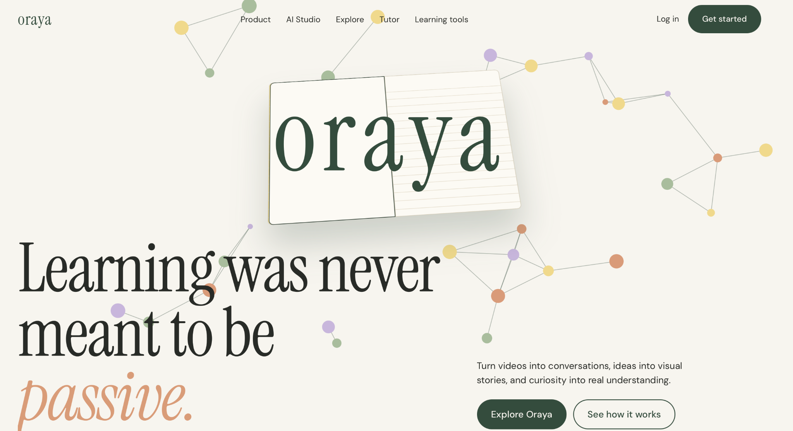
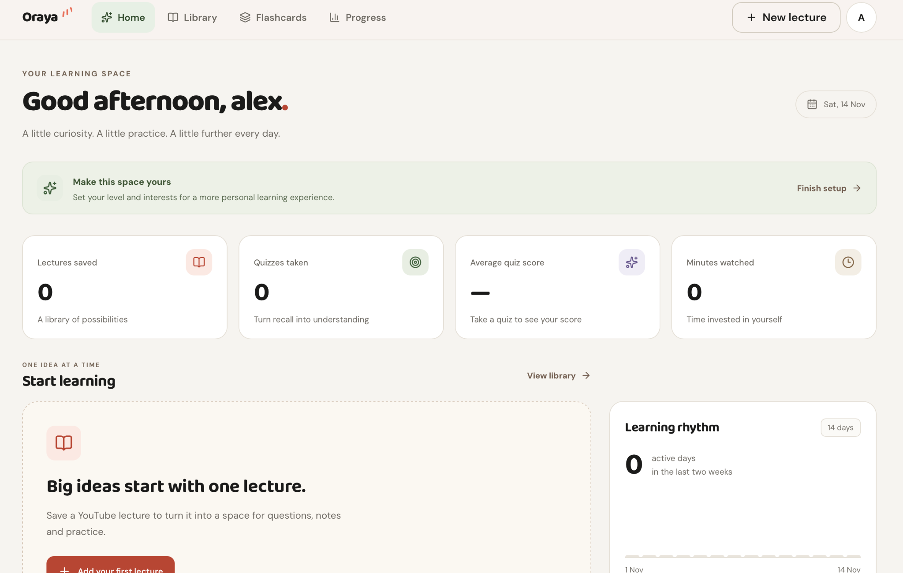
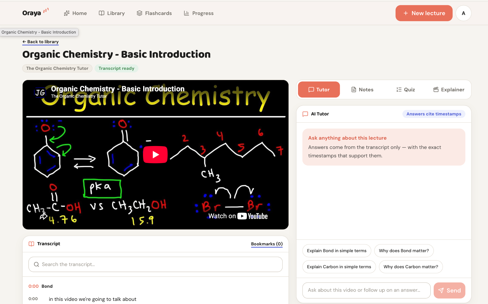
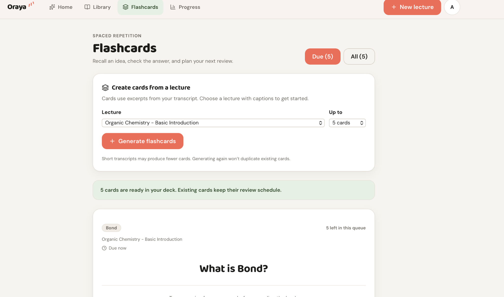

<div align="center">
  
  <br />
  <h1>ORAYA</h1>
  <p><strong>DON'T JUST WATCH. UNDERSTAND.</strong></p>
  <p>A video-first AI learning workspace that turns lectures into conversations, notes, quizzes, explainers, and active recall.</p>
  <p>
    <a href="#-overview">Overview</a> ·
    <a href="#-product-experience">Product experience</a> ·
    <a href="#-system-architecture">Architecture</a> ·
    <a href="#-getting-started">Getting started</a> ·
    <a href="#-security--configuration">Configuration</ a>
  </p>
  <p>
    
    
    
    
    
  </p>
</div>

---

## Contents

- [Overview](#-overview)
- [The learning problem](#-the-learning-problem)
- [Product experience](#-product-experience)
- [Core capabilities](#-core-capabilities)
- [Learning workflow](#-learning-workflow)
- [System architecture](#-system-architecture)
- [Technology stack](#-technology-stack)
- [Repository structure](#-repository-structure)
- [Getting started](#-getting-started)
- [Security & configuration](#-security--configuration)
- [API & documentation](#-api--documentation)
- [Development & verification](#-development--verification)
- [Roadmap](#-roadmap)
- [Contributing](#-contributing)

## 🌿 Overview

**Oraya is an AI-powered, video-first learning environment built around active understanding rather than passive viewing.** It brings a learner's lecture, transcript, questions, revision material, and learning activity into one connected workspace.

Instead of treating a video as a one-way stream, Oraya makes it a starting point for exploration. Learners can follow the transcript, ask questions in context, revisit important concepts, and turn lecture material into practice.

> **Learning was never meant to be passive.**

## 🎯 The learning problem

Online lectures make knowledge accessible, but watching a lesson does not automatically lead to understanding or long-term recall. Learners often have to move between separate tools to take notes, clarify doubts, prepare quizzes, and revise what they have studied.

Oraya brings these activities closer to the source material. The lecture remains the centre of the experience, while AI-assisted study tools help learners engage with it before, during, and after watching.

## 🪄 Product experience

### 01 — A calmer way into learning

The landing experience introduces Oraya's visual language: warm paper tones, forest-green typography, editorial serif lettering, and a connected network motif. The interface is designed to feel thoughtful and welcoming without distracting from the learning task.

<div align="center">
  
  <sub>Oraya · Landing experience</sub>
</div>

### 02 — A personal learning space

The dashboard brings together saved lectures, quizzes taken, average quiz score, minutes watched, and recent learning rhythm. It gives learners a snapshot of their activity and a clear next step for continuing their learning.

<div align="center">
  
  <sub>Home · Learning dashboard</sub>
</div>

### 03 — The lecture workspace

The lecture view keeps the video and transcript alongside study tools. The AI Tutor is designed to answer questions using lecture transcript context and surface supporting timestamps, so learners can connect an explanation to the relevant part of a lesson.

<div align="center">
  
  <sub>Lecture workspace · Video, transcript and AI Tutor</sub>
</div>

### 04 — Revision through active recall

Flashcards turn transcript excerpts into review prompts. Learners can work through cards that are due, switch to the full deck, and build a repeatable revision habit through spaced review.

<div align="center">
  
  <sub>Flashcards · Recall and spaced repetition</sub>
</div>

## ✨ Core capabilities

| Capability | Purpose |
|---|---|
| **Learning dashboard** | View saved lectures, quiz activity, average score, minutes watched, and learning rhythm. |
| **Lecture library** | Keep lecture-based learning material organised in one place. |
| **Video + transcript workspace** | Watch a lecture while searching and following its transcript. |
| **AI Tutor** | Ask lecture-related questions with answers grounded in transcript context and timestamp references. |
| **Notes** | Keep study notes connected to the lecture workspace. |
| **Quizzes** | Practise and check understanding of lecture topics. |
| **Explainer** | Explore concepts through a focused explanation experience. |
| **Flashcards** | Generate revision cards from transcript excerpts and review due cards. |
| **Progress** | Track learning activity and revisit study patterns over time. |

*Availability of AI-powered and background workflows depends on the configured backend services and provider credentials. Refer to the implementation and API documentation before assuming a feature is enabled in a given deployment.*

## 🔄 Learning workflow

```text
                 ADD A LECTURE
                       │
                       ▼
                CREATE A STUDY SPACE
                       │
          ┌────────────┼────────────┐
          ▼            ▼            ▼
       Watch video  Read transcript  Search content
          └────────────┼────────────┘
                       ▼
                  ASK THE AI TUTOR
                       │
                       ▼
               BUILD UNDERSTANDING
                       │
          ┌────────────┼────────────┐
          ▼            ▼            ▼
         Notes        Quiz        Explainer
          └────────────┼────────────┘
                       ▼
                 CREATE FLASHCARDS
                       │
                       ▼
               REVIEW & TRACK PROGRESS
```

## 🏗 System architecture

Oraya is organised as a web client connected to an API backend, with supporting services for AI-assisted learning and media workflows.

```text
┌──────────────────────────────────────────────┐
│                LEARNER / BROWSER              │
└──────────────────────┬───────────────────────┘
                       │
                       ▼
┌──────────────────────────────────────────────┐
│          REACT + TYPESCRIPT FRONTEND          │
│       Vite · React Router · Tailwind CSS      │
└──────────────────────┬───────────────────────┘
                       │ /api/*
                       ▼
┌──────────────────────────────────────────────┐
│         NODE / EXPRESS DEVELOPMENT SERVER     │
│             API forwarding / BFF             │
└──────────────────────┬───────────────────────┘
                       │
                       ▼
┌──────────────────────────────────────────────┐
│               FASTAPI BACKEND                │
│       Auth · Learning · Content · AI          │
└───────────────┬──────────────────┬───────────┘
                │                  │
                ▼                  ▼
       ┌────────────────┐  ┌──────────────────┐
       │ Data & storage │  │ AI / media flows │
       │ DB · Redis     │  │ Gemini · workers │
       └────────────────┘  └──────────────────┘
```

The diagram is a high-level view of the repository's service boundaries, not a claim that every optional integration is active in every environment. See [`docs/BACKEND_OVERVIEW.md`](docs/BACKEND_OVERVIEW.md), [`docs/API_REFERENCE.md`](docs/API_REFERENCE.md), and [`docs/MEDIA_AND_WORKERS.md`](docs/MEDIA_AND_WORKERS.md) for implementation details.

## 🧰 Technology stack

| Layer | Technologies used in the repository |
|---|---|
| Frontend | React 19, TypeScript 5.8, Vite 6, Tailwind CSS 4, React Router 7 |
| UI & interaction | Motion, Lucide React, Recharts, React Markdown |
| Web server / proxy | Node.js, Express, `tsx`, WebSocket support |
| Backend API | Python, FastAPI, Uvicorn |
| AI integration | Google Gen AI SDK / Gemini integration |
| Data & background services | Database configuration, Redis integration, worker-based media workflows |
| Animation service | Separate Python service in `animation-engine/` |
| Deployment | Docker Compose and Nginx configuration are included in the repository |

## 📁 Repository structure

```text
.
├── frontend/                 # React + TypeScript + Vite client
│   ├── src/                  # Pages, components, hooks and client logic
│   ├── public/               # Static frontend assets
│   ├── server.ts             # Express development / API forwarding server
│   ├── package.json
│   └── .env.example
│
├── backend/                  # FastAPI application
│   ├── app/
│   │   ├── api/              # API routes
│   │   ├── core/             # Config, database, auth and shared services
│   │   ├── repositories/     # Data access layer
│   │   ├── schemas/          # Request / response schemas
│   │   └── services/         # Application services
│   └── requirements.txt
│
├── animation-engine/         # Separate animation-generation service
├── ingestion/                # Content ingestion utilities
├── sim/                      # Simulation assets and data
├── nginx/                    # Nginx configuration
├── docs/                     # Architecture, API and operational documentation
│   └── assets/               # README screenshots
├── docker-compose.yml
└── README.md
```

## 🚀 Getting started

### Prerequisites

- Git
- Node.js and npm
- Python (use a version compatible with `backend/requirements.txt`)
- A terminal with `venv` support
- Redis and database services if required by the workflows you intend to run
- Gemini API key for Gemini-powered functionality

### 1. Clone the repository

```bash
git clone <YOUR_REPOSITORY_URL>
cd <YOUR_REPOSITORY_FOLDER>
```

### 2. Configure and start the backend

```bash
cd backend
python3 -m venv .venv
source .venv/bin/activate        # macOS / Linux
# .venv\Scripts\activate       # Windows
pip install --upgrade pip
pip install -r requirements.txt
```

Create or configure the backend environment file using the variables documented in `backend/app/core/config.py` and the repository's `.env.example`. Do not copy placeholder values into production. Start the API from the `backend/` directory:

```bash
uvicorn app.main:app --reload --host 127.0.0.1 --port 8000
```

When the API is running, its interactive documentation is normally available at:

- Swagger UI: `http://127.0.0.1:8000/docs`
- OpenAPI schema: `http://127.0.0.1:8000/openapi.json`

### 3. Configure and start the frontend

Open a second terminal at the repository root:

```bash
cd frontend
cp .env.example .env
npm install
```

Set the local API and provider values in `frontend/.env`:

```env
VITE_API_URL=/api
BACKEND_API_URL=http://127.0.0.1:8000
GEMINI_API_KEY=your_gemini_api_key
```

`GEMINI_API_KEY` is only needed for workflows that call Gemini. Keep real keys in local environment files or your deployment platform's secret manager. Never commit secrets.

Start the frontend development server:

```bash
npm run dev
```

Open the local address printed in the terminal. The repository's frontend `dev` script starts the Express/TypeScript server, which serves the Vite application and forwards configured API requests to the backend.

### 4. Optional services

Some media, queue, animation, or storage workflows may require additional services. Review the corresponding operational guides before starting them:

- [`docs/RUNNING.md`](docs/RUNNING.md)
- [`docs/MEDIA_AND_WORKERS.md`](docs/MEDIA_AND_WORKERS.md)
- [`docs/deployment.md`](docs/deployment.md)
- [`docker-compose.yml`](docker-compose.yml)

## 🔐 Security & configuration

- Store API keys, database credentials, signing secrets, and storage credentials in environment variables or a managed secrets store.
- Do not commit `.env` files, private keys, access tokens, or user data.
- Use separate credentials and configuration for local development and production.
- Restrict CORS, trusted hosts, database access, and storage permissions to the deployment environment.
- Do not expose provider keys in browser-delivered code. Frontend variables prefixed with `VITE_` are public at build time; secrets belong on the server.
- Treat AI-generated explanations as assistance. Validate important academic content against the original lecture and trusted learning resources.

## 📚 API & documentation

The backend exposes its API through FastAPI. For the live endpoint list and request schemas, use the generated `/docs` page from the running backend. The repository also includes supporting documentation:

| Document | What it covers |
|---|---|
| [`docs/API_REFERENCE.md`](docs/API_REFERENCE.md) | API routes and data contracts |
| [`docs/BACKEND_OVERVIEW.md`](docs/BACKEND_OVERVIEW.md) | Backend structure and service responsibilities |
| [`docs/AUTH_AND_RBAC.md`](docs/AUTH_AND_RBAC.md) | Authentication and access-control notes |
| [`docs/FRONTEND_BACKEND_INTEGRATION.md`](docs/FRONTEND_BACKEND_INTEGRATION.md) | Frontend-to-backend integration |
| [`docs/MEDIA_AND_WORKERS.md`](docs/MEDIA_AND_WORKERS.md) | Media processing and worker workflows |
| [`docs/deployment.md`](docs/deployment.md) | Deployment guidance |

## 🧪 Development & verification

Frontend scripts currently defined in `frontend/package.json`:

```bash
npm run dev       # Start the development server
npm run build     # Build the frontend and bundle the server
npm run start     # Start the built server
npm run preview   # Preview the Vite build
npm run lint      # Run TypeScript type checking
```

Backend tests and operational checks are maintained alongside the backend. Run the relevant test suite from the backend environment and consult the test files and documentation before interpreting a passing result as full end-to-end coverage.

## 🗺 Roadmap

The following are product-development directions, not promises that every item is already implemented:

- [ ] Continue improving transcript-grounded tutoring and source timestamps.
- [ ] Expand lecture-linked notes, quizzes, and explainers.
- [ ] Improve spaced-repetition scheduling and revision insights.
- [ ] Strengthen learning analytics and progress visualisation.
- [ ] Improve reliability and observability across AI and media workflows.
- [ ] Expand accessibility and responsive learning experiences.

## 🤝 Contributing

Contributions, bug reports, and thoughtful feature suggestions are welcome.

1. Fork the repository.
2. Create a focused branch: `git checkout -b feat/your-feature`.
3. Make and test your changes.
4. Keep secrets and generated local data out of commits.
5. Open a pull request describing the change, how it was tested, and any configuration it requires.

## 📄 License

No license file was identified in the repository at the time this README was prepared. Add a `LICENSE` file before distributing the project under specific reuse terms.

---

<div align="center">
  <strong>ORAYA</strong><br />
  <sub>Make every lecture a starting point.</sub>
</div>
